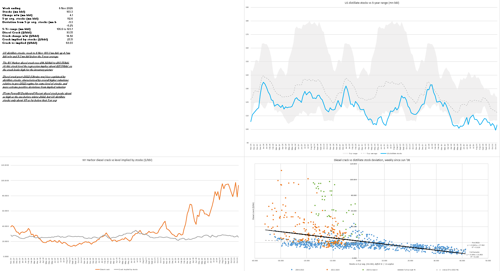
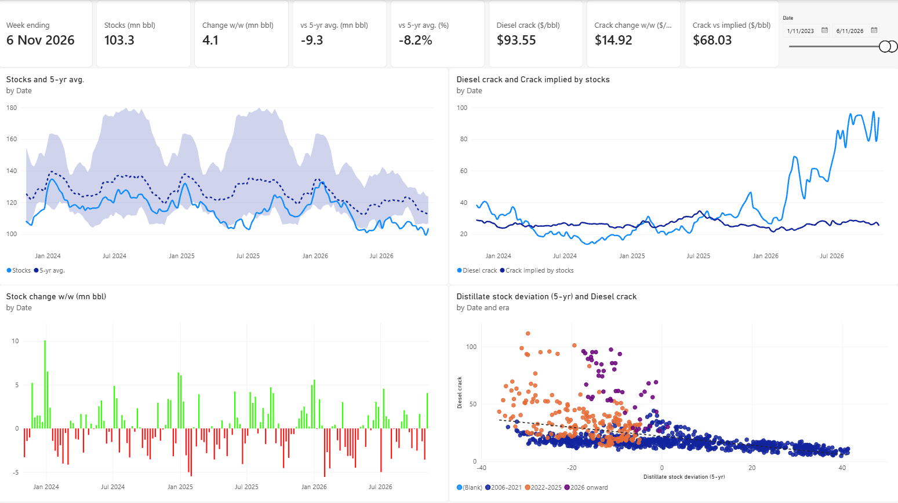

# US distillate stocks and the diesel crack

An weekly report that updates in about 5 mins on US distillate inventories (diesel and heating oil) and the NY Harbor diesel crack, built as an Excel dashboard and a Power BI report from free EIA data.

It answers the two questions a trader asks after the EIA's Wednesday inventory release:

1. Did US distillate stocks build or draw, and where do they sit against the 5-year range?
2. Is the diesel crack where the stock level says it should be?

## View it

- **Excel dashboard:** [open in your browser](https://1drv.ms/x/c/6334d34aa6282d9f/IQCYD1BPna7OQLSb3CTmpVPJAfacsZLmJ_s3F_s1h4MsdUU?e=fHAnCv) (no download needed), or download [`A_us_distillates_dashboard.xlsx`](us-distillates/A_us_distillates_dashboard.xlsx)
- **Power BI report:** download [`A_us_distillates.pbix`](us-distillates/A_us_distillates.pbix) and open it in Power BI Desktop (free, Windows only)

Both files contain a saved copy of the data through the week ending 6 Nov 2026. Refresh won't work on another computer, because the dashboards read a data file that isn't in this repo.

## Key findings (data through 6 Nov 2026)

- **Stocks are tight.** US distillate stocks were 103.3 mn bbl, 9.3 mn bbl (8.2%) below the 5-year average and below the bottom of the 5-year range (106.6 mn bbl).
- **Before 2022, low stocks meant only a slightly higher crack.** From 2006 to 2021 (pre-2022), each 1 mn bbl of stocks below the 5-year average went with a crack about $0.16/bbl higher (R² 0.32). Each 10 mn bbl deficit added roughly $1.60/bbl.
- **Since 2022, the crack has run far above that line.** The same kind of line fitted to 2022 onward (post-2022) is both higher and steeper. To illustrate, each 1 mn bbl below average adds about $0.73/bbl (against $0.16 for pre-2022), which implies each 10 mn bbl deficit adds about $7.30/bbl. The post-2022 relationship puts the implied crack at about $36/bbl, against about $19/bbl on the pre-2022 relationship. The newer relationship is also less explantory of post-2022 prices (R² 0.08). In the scatter, the 2022-2025 and 2026 points sit mostly above the older ones and are much more spread out.
- **Right now, stocks explain almost none of the crack.** The crack was $93.55/bbl, about $68 above the $25.51 implied by stocks. A line fitted to the last three years explains about 1% of the variation in the crack (R² 0.01), which points to drivers other than US inventories.

## What's in the dashboards

**Excel** (`A_us_distillates_dashboard.xlsx`)

- Latest-week table: stocks, weekly change, gap to the 5-year average (mn bbl and %), 5-year range, crack, crack change and crack implied by stocks
- The opening two sentences of the weekly note, written by formulas from the table
- Stocks against the shaded 5-year range, last 3 years
- The crack against the level implied by stocks, last 3 years
- Crack against stock deviation since 2006, coloured by era, with the full-sample and pre-2022 fit lines

**Power BI** (`A_us_distillates.pbix`)

- Date slicer: the cards show the last week in the selected range, so you can step back to any past week
- Latest-week cards built from DAX measures
- Stocks against the 5-year average
- Weekly builds and draws
- The crack against the level implied by stocks
- Crack against stock deviation, coloured by era, with full-sample fit line

## Method

- **Stocks:** EIA weekly US distillate fuel oil ending stocks in million barrels (mn bbl), weekly since Aug 1982.
- **5-year range:** for each week of the year, the average, low and high of the same week over the previous five years.
- **Deviation:** stocks minus the 5-year average. Negative means a deficit.
- **Diesel crack:** NY Harbor ULSD spot price ($/gal × 42 = $/bbl) minus Brent spot ($/bbl), weekly since Jun 2006 when the ULSD series starts.
- **Regression:** a straight line of the crack against the deviation (ordinary least squares, the same as an Excel linear trendline). It's fitted to weekly data from Jun 2006 to Nov 2026 (1,065 weeks), and separately to 2006-2021 and to 2022 onward.
- **Limits:** the fits describe the relationship; they don't test it. Stock levels change slowly, so neighbouring weeks aren't independent observations, and standard p-values would make the fits look more certain than they are. That's why this page quotes slopes and R² but no p-values.
- **Crack implied by stocks:** the full-sample line, 21.86 − 0.394 × deviation. The 2022 and 2026 spikes pull it up, so treat it as a rough guide. The pre-2022 slope is the cleaner historical norm.

The weekly data is prepared and the regressions are run in a Python notebook (pandas, statsmodels), which isn't included here. The dashboards only load its output.

## Data sources

All from the US Energy Information Administration (EIA). The data is free and in the public domain.

- [Weekly Petroleum Status Report](https://www.eia.gov/petroleum/supply/weekly/)
- [US distillate ending stocks, weekly (WDISTUS1)](https://www.eia.gov/dnav/pet/hist/LeafHandler.ashx?n=PET&s=WDISTUS1&f=W)
- [NY Harbor ULSD spot price, weekly](https://www.eia.gov/dnav/pet/hist/LeafHandler.ashx?n=PET&s=EER_EPD2DXL0_PF4_Y35NY_DPG&f=W)
- [Brent spot price, weekly (RBRTE)](https://www.eia.gov/dnav/pet/hist/LeafHandler.ashx?n=PET&s=RBRTE&f=W)

## Tools

Excel (Power Query, XLOOKUP, combo and scatter charts) · Power BI (Power Query, DAX measures, slicers) · Python (pandas, statsmodels) for data preparation

## Files

| Path | What it is |
| --- | --- |
| `us-distillates/A_us_distillates_dashboard.xlsx` | Excel dashboard, with data |
| `us-distillates/A_us_distillates.pbix` | Power BI report, with data |
| `images/` | Screenshots for this page |
